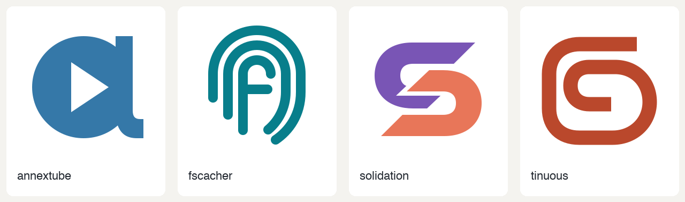

# CON icon exploration

Research, concepts, refinement dialogue, and execution evidence for four CON
project-icon proposals developed on 12–13 October 2026.

| Project | Exploration | Draft proposal |
| --- | --- | --- |
| annextube | [Tape a and alternatives](projects/annextube/) | [PR 38](https://github.com/con/annextube/pull/38) |
| fscacher | [Fingerprint f and alternatives](projects/fscacher/) | [PR 117](https://github.com/con/fscacher/pull/117) |
| solidation | [Conversation S and alternatives](projects/solidation/) | [PR 53](https://github.com/con/solidation/pull/53) |
| tinuous | [Record ribbon and alternatives](projects/tinuous/) | [PR 234](https://github.com/con/tinuous/pull/234) |

Each project directory contains the research rationale, rejected and retained
concepts, render scripts, previews, and submitted assets. Maintainers can choose,
revise, or replace these proposals; they are not adopted project identities.

The initial generic icons were produced by GPT-6 Luna at low effort and rejected.
The revised design used one GPT-6 Astra agent at medium effort per project, with
the [logo-design skill](documents/logo-design-SKILL.md), actual project objectives,
and CON/field logos as references. Agents exchanged critiques and refined their
marks. The replacement icon commits were authored by Astra at medium effort.
Luna agents at medium effort investigated and fixed the tinuous CI failures;
their diagnoses are [typing](projects/tinuous/ci-typing.md) and
[fork integration](projects/tinuous/ci-install.md).

[Conversation exports](conversations/) contain available user-facing dialogue,
delegation metadata, and agent conclusions from the task recordings. They exclude
hidden reasoning, system instructions, and credential configuration. Some peer
message bodies are encrypted in the local recording; the export marks those gaps,
and the individual design rationales summarize their critiques. These exports are
partial histories, not reconstructed verbatim transcripts of unavailable messages.

[Duct logs](duct/) retain local commands, output, failures, and resource samples.
Hostnames and any environment snapshots are redacted in the published metadata;
original local captures remain intact. Historical paths identify the original
working locations. A command capture with a dirty working tree does not preserve
every input, and these logs are not a complete replay environment. Duct measures
local processes; it does not measure remote model token usage or compute.

[Documents](documents/) preserves the selected skill and initial proposal/showcase
documents. The skill is copied from
[atypica-ai/logo-design-skill at d0a24ba](https://github.com/atypica-ai/logo-design-skill/tree/d0a24ba82431e1ad4e29fc3480c83fb8f0aa6ada)
with its [license](documents/logo-design-LICENSE). Existing CON/field reference
marks retain their original owners' rights. No blanket license is asserted for
third-party reference artwork.
