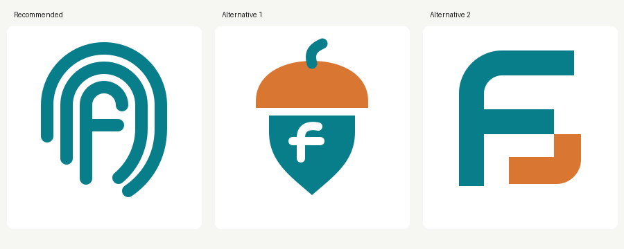

# fscacher icon exploration

Read the [research and refinement rationale](exploration/rationale.md), the [design dialogue](../../conversations/fscacher_design.md), and the [retained execution logs](../../duct/).

The `exploration/` directory retains concept iterations, render scripts, and previews. `initial-proposal/` preserves the rejected first attempt. `proposed-assets/` contains the candidates submitted for maintainer review.
